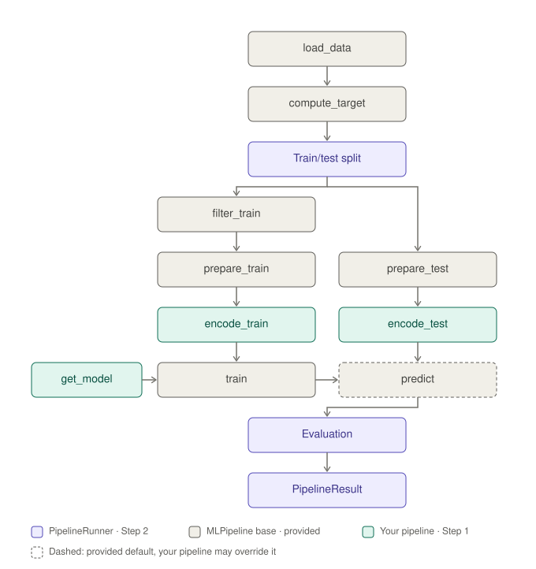

# Fairness Auditing Practical


---

## Overview

In this practical you will build a **fairness auditing system** for machine
learning (ML) pipelines, applied to the
[Adult Income dataset](https://archive.ics.uci.edu/dataset/2/adult)
(also known as "Census Income"), extracted from the 1994 US Census database.
This is the same dataset that the Kaggle notebooks you will refactor were
written for.

You will:

1. Understand an abstract ML pipeline base class and adapt four real Kaggle
   notebooks to use it.
2. Implement the basic evaluation metrics and build a pipeline runner that
   evaluates predictive performance.
3. Implement a **prediction matcher** that maps model predictions back to
   the original (possibly filtered) source data.
4. Implement a **fairness auditor** that slices predictions by protected
   attributes and computes group-fairness metrics *from scratch* — no
   fairness library allowed. This includes defining which groups are
   considered unprivileged and why, and wiring everything into the
   end-to-end demo.
5. *(Optional bonus)* Build your own pipeline that is fairer than the
   refactored ones, within the same framework.

---

## Repository Structure

```
.
├── data/
│   ├── adult.csv                    ← dataset (already present)
│   └── example-notebooks/           ← Kaggle notebooks to refactor (already present)
│       ├── adult-income-prediction-ml-81-6.ipynb
│       ├── adult-income-prediction-with-logistic-regression.ipynb
│       ├── classification-analysis-with-xgboost.ipynb
│       ├── eda-logistic-regression-pca.ipynb
│       └── effective-adult-income-classification-pipeline.ipynb
├── docs/
│   └── pipeline_flow.svg            ← figure: one pipeline run, who does what
├── pipeline_auditing/               ← framework code
│   ├── base.py                      ← abstract MLPipeline class         [Step 1]
│   ├── metrics.py                   ← evaluation metric functions        [Step 2a, 4b]
│   ├── runner.py                    ← PipelineRunner + PipelineResult   [Step 2b]
│   └── fairness/
│       ├── matcher.py               ← PredictionMatcher                 [Step 3]
│       ├── groups.py                ← UnprivilegedGroups base class      [Step 4a]
│       └── auditor.py               ← FairnessAuditor + AuditReport     [Step 4b]
├── pipelines/                       ← concrete pipeline implementations
│   ├── pipeline_baseline.py         ← Pipeline 0: Random Baseline       [Step 1]
│   ├── pipeline_ml816.py            ← Pipeline 1: ML816 (Logistic+Threshold) [Step 1]
│   ├── pipeline_logistic_regression.py ← Pipeline 2: Logistic Regression (OHE) [Step 1]
│   ├── pipeline_xgboost.py          ← Pipeline 3: XGBoost               [Step 1]
│   ├── pipeline_logistic_pca.py     ← Pipeline 4: Logistic + PCA        [Step 1]
│   ├── pipeline_effective.py        ← Pipeline 5: Effective (Random Forest) [Step 1]
│   └── pipeline_fair.py             ← Pipeline 6: your fair pipeline     [Bonus]
├── tests/
│   ├── conftest.py                  ← shared fixtures (synthetic data)
│   ├── test_pipelines.py
│   ├── test_notebook_accuracy.py    ← Step 1 sanity check on the real data
│   ├── test_metrics.py
│   ├── test_runner.py
│   ├── test_matcher.py
│   ├── test_groups.py
│   ├── test_auditor.py
│   ├── test_end_to_end.py           ← runner → matcher → auditor, and main.py
│   └── test_bonus.py                ← bonus rules and minimum quality
├── main.py                          ← end-to-end demo script
└── requirements.txt
```

---

## Setup

### 1. Install dependencies

```bash
python -m venv .venv
source .venv/bin/activate
pip install -r requirements.txt
```

### 2. Verify your setup

The dataset (`data/adult.csv`) is already present in the repository — no
download required. It is the file `adult.csv` from
[Kaggle](https://www.kaggle.com/datasets/uciml/adult-census-income).

```bash
# Run all tests
python -m pytest tests/ -v

# Run the end-to-end demo
python main.py
```

---

## Dataset

The dataset contains 32,561 income records from the 1994 US Census, with a
binary target indicating whether income exceeds $50,000 per year.

| Column | Type | Description |
|---|---|---|
| `age` | int | Age in years |
| `workclass` | str | Type of employer (e.g. `Private`, `State-gov`) |
| `fnlwgt` | int | "Final weight": census sampling weight, i.e. the number of people in the population this row represents |
| `education` | str | Highest level of education (e.g. `HS-grad`, `Bachelors`) |
| `education.num` | int | Highest level of education as a number (1 = `Preschool` … 16 = `Doctorate`) |
| `marital.status` | str | Marital status |
| `occupation` | str | Occupation |
| `relationship` | str | Relationship to the head of household (e.g. `Husband`, `Own-child`) |
| `race` | str | Race |
| `sex` | str | Sex |
| `capital.gain` | int | Capital gains |
| `capital.loss` | int | Capital losses |
| `hours.per.week` | int | Hours worked per week |
| `native.country` | str | Country of origin |
| `income` | str | `">50K"` or `"<=50K"` (prediction target) |

Note: Missing values are encoded as the string `"?"` (not as `NaN`) in
`workclass`, `occupation` and `native.country`. The dataset also contains a
small number of exact duplicate rows.

---

## Steps

### Step 1 – Abstract Pipeline & Concrete Implementations

**Files**: [`pipeline_auditing/base.py`](pipeline_auditing/base.py) and the files in [`pipelines/`](pipelines/)

The `MLPipeline` abstract base class defines the pipeline stages.  The
abstract methods every concrete pipeline **must** implement are:

| Method | Responsibility |
|---|---|
| `encode_train(data)` | **Fit** encoders/scalers on training features and return a numeric `DataFrame` (same index as input) |
| `encode_test(data)` | **Transform** test features using encoders fitted in `encode_train` — must **not** call `fit`. Returns a numeric `DataFrame` with the same index as the input and the same columns, in the same order, as `encode_train` |
| `get_model()` | Return a fresh, untrained sklearn estimator |

All other steps of the pipeline (e.g. loading the data, training, predicting, etc.) are already implemented in the base 
class and do not need to be overridden, you will use them later for the runner (step 2). Exception: it is acceptable to 
override `predict` only for explicit post-processing of model outputs (e.g. applying a custom probability threshold as in [`ML816Pipeline`](pipelines/pipeline_ml816.py)).

The figure below shows one complete run of a pipeline and who is responsible for each step:



The pipelines wired into `main.py` are:

| ID | Class | Algorithm | Source Notebook |
|---|---|---|---|
| Pipeline 0 | `RandomBaselinePipeline` | Random predictions | — (baseline) |
| Pipeline 1 | `ML816Pipeline` | Logistic Regression + threshold=0.6 | `adult-income-prediction-ml-81-6.ipynb` |
| Pipeline 2 | `LogisticRegressionPipeline` | Logistic Regression (OHE) | `adult-income-prediction-with-logistic-regression.ipynb` |
| Pipeline 3 | `XGBoostPipeline` | XGBoost | `classification-analysis-with-xgboost.ipynb` |
| Pipeline 4 | `LogisticPCAPipeline` | Logistic Regression + PCA | `eda-logistic-regression-pca.ipynb` |
| Pipeline 5 | `EffectivePipeline` | Random Forest | `effective-adult-income-classification-pipeline.ipynb` |

**Your tasks**:

1. Read [`pipeline_auditing/base.py`](pipeline_auditing/base.py) and ensure you understand the interface.
2. Look at the example pipeline [`pipelines/pipeline_baseline.py`](pipelines/pipeline_baseline.py) that is a minimal pipeline that satisfies the interface.
3. Study the five Kaggle notebooks provided in [`data/example-notebooks/`](data/example-notebooks/).
4. Inspect the example notebook [`data/example-notebooks/adult-income-prediction-ml-81-6.ipynb`](data/example-notebooks/adult-income-prediction-ml-81-6.ipynb) and the corresponding 
   refactored pipeline [`pipelines/pipeline_ml816.py`](pipelines/pipeline_ml816.py) and understand how they relate to each other.
5. Refactor the remaining four notebooks into the corresponding pipeline skeletons by
   implementing the abstract methods (`encode_train`, `encode_test`, `get_model`),
   using the algorithm given in the table above. Two notebooks need special treatment:
   * **Pipeline 4 (Logistic Regression + PCA):** use all features, encoded and
     scaled as in the notebook, followed by a PCA that keeps enough components
     to explain 90% of the variance, and a logistic regression on these components.
   * **Pipeline 5 (Effective):** skip the oversampling of the minority class.

   As a sanity check: the framework uses its own train/test split, so your
   accuracies will not be identical to the ones in the notebooks, but they
   should be within about one percentage point.
6. Run `pytest tests/test_pipelines.py tests/test_notebook_accuracy.py -v` — all
   tests must pass. The second file checks the accuracy of each pipeline on the
   real data against its notebook.
7. **In your written report**, list for each pipeline where your refactored
   version deviates from the original notebook, and explain why.

---

### Step 2 – Evaluation Metrics & Pipeline Runner

#### Step 2a – Evaluation metrics ([`pipeline_auditing/metrics.py`](pipeline_auditing/metrics.py))

The runner evaluates every pipeline with your own implementation of the basic
classification metrics. Implement them using only `numpy` (no `sklearn.metrics`):

```python
def confusion_matrix_counts(y_true, y_pred, positive_label=1) -> (TP, FP, TN, FN)
def accuracy(y_true, y_pred) -> float
def positive_rate(y_pred, positive_label=1) -> float
def true_positive_rate(y_true, y_pred, positive_label=1) -> float   # TPR / recall
def false_positive_rate(y_true, y_pred, positive_label=1) -> float  # FPR
def precision(y_true, y_pred, positive_label=1) -> float            # PPV
def f1(y_true, y_pred, positive_label=1) -> float
def safe_divide(numerator, denominator, default=NaN) -> float
```

Every metric returns `NaN` (via `float('nan')`) whenever it is undefined
(e.g. precision when there are no positive predictions).

Run `pytest tests/test_metrics.py -v`; these tests also compare your
functions with scikit-learn.

#### Step 2b – Pipeline Runner ([`pipeline_auditing/runner.py`](pipeline_auditing/runner.py))

Implement `PipelineRunner.run(pipeline, filepath)`. It carries out one complete
run of a pipeline, as shown in the [figure](docs/pipeline_flow.svg) in Step 1:
the purple steps are the runner's own work, everything else it delegates to
the pipeline.

Most of the work is already done by the pipeline: the methods implemented in
[`base.py`](pipeline_auditing/base.py) (and your encoders from Step 1). Do not
reimplement them; your task is to call them on the right data, in the right
order, and to write the parts marked *your code*:

| Part of a run | Who does it |
|---|---|
| Load the data and determine the prediction target for every row | pipeline (`base.py`) |
| Split the rows into a training and a test set, with the same share of high earners in both (split size and random seed are settings of the runner) | *your code* |
| Remove unwanted rows, from the training set only, so the test set always contains every row that is not used for training | filtering: pipeline (`base.py`); applying it to the right rows: *your code* |
| Encode the features, learning everything from the training set only and applying it unchanged to the test set | pipeline (`base.py`, using your Step 1 encoders); using it correctly: *your code* |
| Train the model and predict the test set | pipeline (`base.py`) |
| Evaluate the predictions (accuracy, F1, precision, recall, ROC-AUC) | a provided helper in `runner.py`, using your Step 2a functions (ROC-AUC comes from scikit-learn) |
| Return a `PipelineResult` with all intermediate results | *your code* (the dataclass is defined in `runner.py`) |

This unified framework allows you to directly compare the performance of the five different pipelines under identical settings.

**Questions to answer** (in the final written report):

* Which pipeline achieves the highest accuracy?  Which achieves the best F1?
* Scenario A: Imagine you would be a data scientist working loyally for a bank, and you would use this algorithm to predict the income of a group
 of potential customers. Based on your results, the bank would reach out and offer those your algorithm deems as high-income an exclusive offer, so
 it is important that you are as certain as possible that those deemed high-income by your algorithm are actually high earners. Which of the five
 pipelines would you choose for this purpose and why?
* Scenario B: Now imagine you would be a data scientist working for the city administration and there would be a new legislation concerning high-income individuals.
 Given this algorithm, you are supposed to predict the income of the city residents, such that the city administration can send out letters to all potentially
 high-income individuals. You should be as certain as possible that your algorithm picks up on all high-income individuals and does not miss out a high-income earner,
 if a letter would be sent accidentally to a low-income earner, it would not be a big problem. Which of the five pipelines would you choose in this case and why?

Run `pytest tests/test_runner.py -v` to validate your implementation.

---

### Step 3 – Prediction Matcher

**File**: [`pipeline_auditing/fairness/matcher.py`](pipeline_auditing/fairness/matcher.py)

After a pipeline run, we only have the bare predictions on the **test split** of the
dataset. To perform fairness analysis we need to relate predictions back to the original demographic data for all rows.
The membership flags additionally record which rows the model was trained on,
which rows it was tested on, and which rows were removed by `filter_train`, so
that predictions can later be audited on different parts of the data (see Step 4c).

Implement `PredictionMatcher.match(result)` which:

1. Takes a `PipelineResult`.
2. Returns a copy of `raw_data` augmented with five new columns:

| Column | Meaning |
|---|---|
| `y_true` | ground-truth label (`NaN` for rows removed by `filter_train`) |
| `y_pred` | model prediction (`NaN` for filtered / train rows) |
| `in_model` | `True` if the row was not filtered out |
| `in_test` | `True` if the row is in the test split |
| `in_train` | `True` if the row is in the training split |

`match` also takes an optional argument `include_train` (default `False`). If it
is `True`, `y_pred` is filled for the training rows as well, by letting the
trained pipeline predict them.

Also implement the static helper `get_auditable_subset(matched_df)` which
returns only the rows where both `y_true` and `y_pred` are available (i.e. the test split).

Run `pytest tests/test_matcher.py -v`.

---

### Step 4 – Fairness Auditor

**Files**: [`pipeline_auditing/fairness/groups.py`](pipeline_auditing/fairness/groups.py), [`pipeline_auditing/metrics.py`](pipeline_auditing/metrics.py), [`pipeline_auditing/fairness/auditor.py`](pipeline_auditing/fairness/auditor.py)

Implement the full fairness auditing stack from scratch.  You may **not** use
any external fairness library (AIF360, Fairlearn, etc.).

#### Step 4a – Unprivileged group definitions ([`pipeline_auditing/fairness/groups.py`](pipeline_auditing/fairness/groups.py))

Fairness metrics compare an **unprivileged group** against a **privileged
group** for each protected attribute. You should decide as a group which values for each
attribute should be in the unpriviledged group based on world knowledge 
(e.g. socio-economic reasoning, knowledge about historical patterns of discrimination, etc.)
and based on the data distribution in the dataset you operate on. 
All other values not included in the unpriviledged group automatically fall into the priviledged group.
You can find a description of each attribute on the
[UCI dataset page](https://archive.ics.uci.edu/dataset/2/adult).
Keep in mind that missing values (`"?"`) are values as well: decide
deliberately which group they belong to.

The file already contains the `UnprivilegedGroups` abstract base class, which you are supposed to implement in the
AdultIncomeGroups class.

Return format of `get_groups()`:

* **Single value** — if only one value is unpriviledged: `{"attribute": value_x}`
* **List of values** — auditor **combines** them into a single unprivileged group
  and computes metrics over the union of rows:
  `{"attribute": [value_x, value_y, value_z]}`

**Your tasks**:

1. Read [`pipeline_auditing/fairness/groups.py`](pipeline_auditing/fairness/groups.py) and understand the interface.
2. Decide as a group which attributes you deem as protected attributes, **justify this choice
   in the written report**. You may want to look up anti-discrimination laws and regulations regarding protected attributes.
3. Examine the dataset: look at the unique values and group sizes for each of
   the protected attributes.
4. Decide which values you deem as unpriviledged for each of the protected attributes and 
   **justify each choice** in your written report (citing either the data
   distribution or socioeconomic reasoning).
5. Implement the AdultIncomeGroups class that is a subclass of  `UnprivilegedGroups`, 
   and implement `get_groups()`, which returns the dictionary with protected attribute names
   as keys and one or more attribute values as dictionary values.

Run `pytest tests/test_groups.py -v` to validate the interface contract. The
tests also check that every attribute and value you list actually occurs in the
dataset (e.g. `"Female"`, not `"female"`).

#### Step 4b – Fairness Auditor ([`pipeline_auditing/metrics.py`](pipeline_auditing/metrics.py), [`pipeline_auditing/fairness/auditor.py`](pipeline_auditing/fairness/auditor.py))

First implement `compute_group_metrics` in `metrics.py`. It computes all
metrics of one group (positive rate, TPR, FPR, precision and accuracy) with
your functions from Step 2a:

```python
def compute_group_metrics(y_true, y_pred, group_value, positive_label) -> GroupMetrics
```

Then implement `FairnessAuditor._audit_attribute()`. For one protected attribute it
compares the unprivileged group (as defined in your `AdultIncomeGroups`) with the
privileged group (all other values of that attribute), and returns an
`AttributeAuditResult` with the metrics of both groups and four fairness metrics:

* **Demographic Parity Difference** (DPD)
* **Equal Opportunity Difference** (EOD)
* **Predictive Parity Difference** (PPD)
* **Accuracy Parity Difference** (APD)

Each fairness metric is a difference *unprivileged − privileged*, so 0 is ideal
and a negative value means the unprivileged group is worse off. The
[glossary](#fairness-concepts-glossary) explains what each criterion compares;
the docstring of `_audit_attribute` describes the expected result.

Run `pytest tests/test_auditor.py -v`.

Finally, run `pytest tests/test_end_to_end.py -v` to check that runner,
matcher and auditor work together, and that `main.py` runs completely.

#### Step 4c – Analysis (for written final report)

Run `python main.py` and answer:

1. Inspect the results of the fairness audit and answer: **Which of the five pipelines is the fairest** with respect to `sex` and `race`?  Justify
   using Demographic Parity Difference (DPD) and Equality of Opportunity Difference (EOD). 
2. Can you explain **why** this pipeline is fairer than the others? 
3. Why is this pipeline still **not** perfectly fair towards `sex` and `race`? 
4. Is there a **fairness–accuracy trade-off** between the five pipelines?
   Discuss using the metrics from Steps 2 and 4.
5. **Reflect on your group choices** (from Step 4a).  Would using a
   different unprivileged group definition change which pipeline appears
   fairest?  Try swapping one definition and report what changes.
6. **Training vs. test data.** Audit every pipeline a second time, on its
   training rows instead of its test rows (use `include_train=True` and the
   membership flags from Step 3). Which fairness metrics change between the two
   audits, which do not, and why? What does this mean for the data a fairness
   audit should be run on?

---

### Bonus (optional) – Your own fairer pipeline

**File**: [`pipelines/pipeline_fair.py`](pipelines/pipeline_fair.py)

Build your own pipeline `FairPipeline` that is fairer than the pipelines from
Step 1, while staying useful. It runs in exactly the same setup as all other
pipelines and is already listed in `main.py` as Pipeline 6.

**Rules**
* Implement only `encode_train`, `encode_test` and `get_model` (helper methods
  of your own are fine). All other methods of `MLPipeline` stay as they are; in
  particular, you may not change `filter_train` or `predict`.
* `get_model` may return any model, including a model class of your own;
  scikit-learn and xgboost are already installed and recommended for standard
  models. If you write your own model, explain in your report what it does.
* No fairness libraries (AIF360, Fairlearn, etc.).
* Your pipeline may use the protected attributes, e.g. as features or to
  transform other features. If it does, discuss in your report whether this
  is acceptable.
* It must stay useful: on the test rows, accuracy must be at least 0.80 and F1
  at least 0.50 (a model that predicts `<=50K` for everyone is "fair", but useless).

**In your written report**
1. Choose the fairness metric and protected attribute(s) your pipeline should
   improve, using your group definitions from Step 4a, and justify the choice.
2. Describe what you changed and why it should help.
3. Compare your pipeline with the pipelines from Step 1 on accuracy, F1 and all
   four fairness metrics, and discuss the trade-offs you observe.

Run `pytest tests/test_bonus.py -v`. The tests are skipped until you start
implementing `FairPipeline`; they check the rules above and the minimum
accuracy and F1 on the real data.

---

## Running Tests

```bash
# Run all tests
pytest tests/ -v

# Run with coverage report
pytest tests/ --cov=pipeline_auditing --cov=pipelines --cov-report=term-missing

# Run a specific test file
pytest tests/test_auditor.py -v
```

---

## Fairness Concepts Glossary

**Demographic Parity** (Statistical Parity): A model satisfies demographic
parity if the probability of a positive prediction is equal across groups.

**Equal Opportunity**: A model satisfies equal opportunity if the true
positive rate (recall) is equal across groups.

**Predictive Parity**: A model satisfies predictive parity if precision
(positive predictive value) is equal across groups.

**Accuracy Parity**: A model satisfies accuracy parity if its accuracy is
equal across groups.

**Proxy discrimination**: Occurs when a model avoids using a protected
attribute directly but instead uses correlated features (proxies) that
reproduce the same discriminatory effect.

**Note**: These criteria are generally *mutually incompatible* in the
presence of base-rate differences between groups (Chouldechova 2017,
Kleinberg et al. 2017). Part of the analysis asks you to observe this
in practice.
